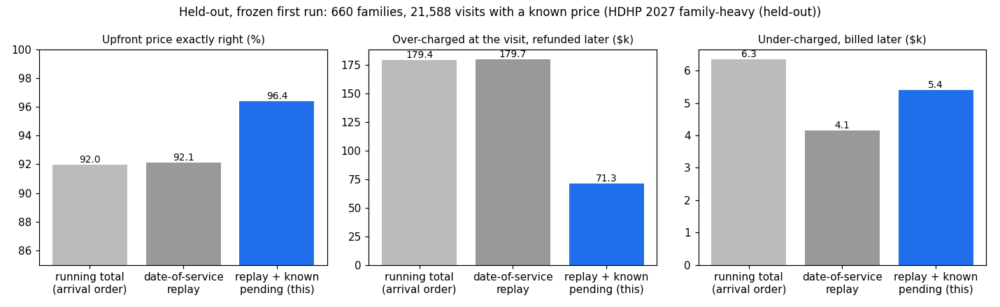

# Upfront prices that stay true when claims arrive out of order

Unofficial prototype by Kushagra Pratap Singh. Not affiliated with Prescience.

Prescience lists "Real-time" claims adjudication, upfront copays in the member app, and HSA funding "just-in-time" at the point of care ([getprescience.com](https://www.getprescience.com/)). The catch is that claims don't arrive in visit order:
- pharmacy claims arrive in seconds;
- office visits take days to weeks;
- ER and hospital claims take months;
- corrected claims arrive later still.

A family's deductible and out-of-pocket accumulators depend on which claims are already counted. So a price shown at the visit, and the HSA money sent for it, can be wrong by hundreds of dollars once an earlier-dated claim lands.



## What it does
- **`ledger/adjudicate.py`.** Member cost share in **date-of-service order**: deductible, copay or coinsurance, out-of-pocket cap, embedded per-person limits in family coverage. One claim's lateness never changes what a family owes.
- **`ledger/quote.py`.** The price at the visit is a replay of the arrived claims, **plus visits the plan already knows about but has no claim for yet** (booked or checked-in, in-network).
  - Known-price visits count at their price. ER / surgery / inpatient visits count at the low end of their range, so a pending visit we knew about never causes a later bill.
  - It returns a **range** (pending visits high, this visit low ↔ the reverse) and **FIRM** when the two ends meet.
- **`ledger/plan.py`.** Plans as data, plus an **HDHP check for HSA-paired plans** with cites:
  - minimum deductible and out-of-pocket max for 2026 (Rev. Proc. 2025-19) and 2027 (Rev. Proc. 2026-24);
  - an embedded per-person deductible below the family minimum;
  - pre-deductible coverage only for preventive care, telehealth (made permanent by OBBBA) and the Notice 2019-45 / 2024-75 chronic list. GLP-1 for weight loss is flagged; insulin is not.
- **`ledger/sim.py`.** A synthetic employer:
  - families of 1–4 people;
  - preventive, telehealth, office, lab, imaging, ER, surgery, inpatient, out-of-network, generic Rx and monthly GLP-1;
  - per-service claim lags;
  - corrected claims;
  - out-of-network visits the plan can't see until the claim arrives.

```
$ python demo.py
Dad's MRI, priced at the visit (day 81):
  running total of arrived claims     $1,450   (only January's lab is posted)
  + son's booked MRI, ER at its floor $1,026   (this; range $290-$1,026, not FIRM: ER claim pending)
  what Dad finally owes               $290   (date-of-service replay once every claim is in)
```

## Results
**Held-out:** [`heldout/config.json`](heldout/config.json), frozen in git (commit `629aced`) before the first run. A family-heavy employer on a 2027 plan; claims 1.6× slower; twice the corrected claims; higher use; new seeds. 660 families; 21,588 visits whose price is known at the visit. First run, nothing changed after it ([`out/heldout_first_run.json`](out/heldout_first_run.json)):

| price at the visit | exactly right | over-charged, refunded later | under-charged, billed later |
|---|---|---|---|
| running total (arrival order) | 92.0% | $179,416 | 62 visits, $6,339 |
| date-of-service replay | 92.1% | $179,746 | 32 visits, $4,140 |
| **replay + known pending visits (this)** | **96.4%** | **$71,252** | 40 visits, $5,398 |

- **FIRM quotes:** 20,561 of 21,588; 20,315 of them right (98.8%). The 246 wrong FIRM quotes come from out-of-network claims the plan could not know about, and from corrected claims.
- **ER / surgery / inpatient:** the final price is inside the quoted range for 408 of 444 visits.
- **Adjudicating each claim once on arrival:** 312 of 660 families owe a different yearly total than the date-of-service rule ($16,011 in all).

Dev (3 seeds, dev plan): 94.9% → 97.6% exact; refunds $31,850 → $13,403. There was one design choice after looking at dev: pending ER-type visits count at the low end, not the median. It cut later bills from 46 to 6, at the cost of 0.7 points of exactness.

## Honest limits
- Later bills are higher than plain replay on held-out ($5,398 vs $4,140). Pending visits count at their first billed amount, and some were later corrected down. Counting pending corrections-prone services at their low end too would fix this, but it is untested.
- Date-of-service accumulation is a plan rule I chose so a visit price can be final. Many payers accumulate in processing order; the replay supports either.
- No networks, pricing, EDI 837/835, eligibility or real members. Synthetic data only; dollars are illustrative.

## Run
```
python demo.py
python evaluate.py heldout          # the table above (~1 min)
python -m pytest -q                 # 6 tests (stdlib; matplotlib only for docs/plot.py)
```
